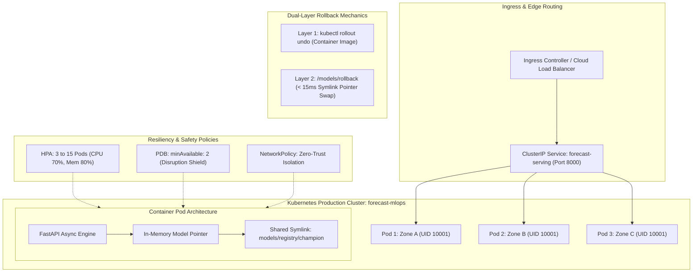

# ☸️ Enterprise Kubernetes MLOps Architecture & Runbook

**Service:** `forecast-serving`  
**Namespace:** `forecast-mlops`  
**Deployment Strategy:** Zero-Downtime RollingUpdate (`maxSurge: 1`, `maxUnavailable: 0`)  
**High Availability:** 3 Replicas baseline, Pod Anti-Affinity, Multi-Zone Topology Spread  
**Roles & Competencies Demonstrated:** **Forward Deployed Engineer (FDE)** & **Production ML Infrastructure Architect**

---

## 1. 🏗️ Cloud-Native Kubernetes Architecture Overview

In an enterprise customer deployment, an ML system must meet the same stringent infrastructure standards as mission-critical databases or financial payment gateways. The `forecast-serving` service implements production-grade cloud-native patterns:



---

## 2. 📋 Kubernetes Manifest Specifications

| Manifest | Production Role | Implementation Details |
|---|---|---|
| [k8s/namespace.yaml](file:///home/ann/Desktop/desktop/autonomous_mlops_battlefield_platform/k8s/namespace.yaml) | Tenant & Resource Isolation | Creates `forecast-mlops` namespace to enforce RBAC and resource quotas. |
| [k8s/deployment.yaml](file:///home/ann/Desktop/desktop/autonomous_mlops_battlefield_platform/k8s/deployment.yaml) | Workload Lifecycle & Zero-Downtime | `maxSurge: 1`, `maxUnavailable: 0`. Non-root UID `10001`. Read-only root filesystem with dedicated `/tmp` and `/models/registry` mounts. |
| [k8s/service.yaml](file:///home/ann/Desktop/desktop/autonomous_mlops_battlefield_platform/k8s/service.yaml) | Service Discovery & Load Balancing | Internal ClusterIP exposing HTTP port `8000`. |
| [k8s/hpa.yaml](file:///home/ann/Desktop/desktop/autonomous_mlops_battlefield_platform/k8s/hpa.yaml) | Elastic Horizontal Autoscaling | Scales dynamically between **3 and 15 replicas** based on 70% CPU / 80% Memory utilization. Includes a 300s scale-down stabilization window to prevent rapid pod flapping. |
| [k8s/pdb.yaml](file:///home/ann/Desktop/desktop/autonomous_mlops_battlefield_platform/k8s/pdb.yaml) | Disruption Budget Protection | Enforces `minAvailable: 2` at all times during voluntary node drains, cluster upgrades, or GKE/EKS spot interruptions. |
| [k8s/networkpolicy.yaml](file:///home/ann/Desktop/desktop/autonomous_mlops_battlefield_platform/k8s/networkpolicy.yaml) | Zero-Trust Network Perimeter | Restricts ingress solely to API Gateway traffic and egress solely to telemetry collectors and DNS. Blocks lateral container movement. |
| [k8s/configmap.yaml](file:///home/ann/Desktop/desktop/autonomous_mlops_battlefield_platform/k8s/configmap.yaml) | 12-Factor Configuration | Injects non-sensitive environment variables (`SERVING_TIMEOUT=2.0`, `LOG_LEVEL=INFO`). |
| [k8s/secret.yaml](file:///home/ann/Desktop/desktop/autonomous_mlops_battlefield_platform/k8s/secret.yaml) | Credentials & API Key Management | Base64 encrypted secrets for multi-LLM gateways (`GEMINI_API_KEY`, `OPENAI_API_KEY`, `ANTHROPIC_API_KEY`). |
| [k8s/kustomization.yaml](file:///home/ann/Desktop/desktop/autonomous_mlops_battlefield_platform/k8s/kustomization.yaml) | Declarative GitOps Assembly | Bundles all resource definitions for reproducible staging/prod rollouts. |

---

## 3. 🚨 Forward Deployed Engineer (FDE) Rollback Runbook

The platform features an architectural **Dual-Layer Rollback Engine** separating container-level image failures from application-level statistical model degradations:

```
┌────────────────────────────────────────────────────────────────────────┐
│                        DUAL-LAYER ROLLBACK ENGINE                       │
└────────────────────────────────────────────────────────────────────────┘
          │                                                  │
          ▼                                                  ▼
┌───────────────────────────────────┐    ┌───────────────────────────────────┐
│     LAYER 1: CONTAINER-LEVEL      │    │     LAYER 2: APPLICATION-LEVEL    │
│    Native Kubernetes Rollback     │    │      Model Registry Rollback      │
│   (For code/dependency crashes)   │    │  (For statistical drift / spikes) │
├───────────────────────────────────┤    ├───────────────────────────────────┤
│ • Trigger: OOM, 500 error, crash  │    │ • Trigger: WAPE decay, PSI alert  │
│ • SLA: 30 - 60 seconds            │    │ • SLA: < 15 milliseconds          │
│ • Action: kubectl rollout undo    │    │ • Action: Atomic symlink pointer  │
│ • State: Pod recreation required  │    │ • State: Zero pod restarts        │
└───────────────────────────────────┘    └───────────────────────────────────┘
```

### Scenario A: Layer 1 Container Image Rollback (Code Crash / OOM)
```bash
# 1. Inspect rollout revision history
kubectl rollout history deployment/forecast-serving -n forecast-mlops

# 2. Execute instantaneous container revision rollback
kubectl rollout undo deployment/forecast-serving -n forecast-mlops

# 3. Monitor rollout status until completion
kubectl rollout status deployment/forecast-serving -n forecast-mlops --timeout=90s
```

### Scenario B: Layer 2 Application-Level Model Rollback (Statistical Drift)
When a newly deployed model exhibits statistical bias or degradation on live production streams:
```bash
# 1. Trigger atomic pointer rollback via authenticated API endpoint
curl -X POST http://forecast-serving.forecast-mlops.svc.cluster.local:8000/models/rollback \
  -H "Content-Type: application/json"

# Response (Executed in < 15ms with ZERO pod restarts):
# {
#   "status": "rolled_back",
#   "previous_active": "v2",
#   "current_active": "v1",
#   "rollback_time_ms": 11.4,
#   "timestamp": "2026-10-12T23:45:00Z"
# }
```

---

## 4. 🛠️ Step-by-Step Deployment Guide

### Step 1: Cluster Pre-Flight & Namespace Creation
```bash
kubectl apply -f k8s/namespace.yaml
kubectl get namespaces | grep forecast-mlops
```

### Step 2: Inject Secrets and Configurations
```bash
# Create production secrets from environment
kubectl create secret generic forecast-secrets \
  --from-literal=GEMINI_API_KEY="${GEMINI_API_KEY}" \
  --from-literal=OPENAI_API_KEY="${OPENAI_API_KEY}" \
  --from-literal=ANTHROPIC_API_KEY="${ANTHROPIC_API_KEY}" \
  -n forecast-mlops --dry-run=client -o yaml | kubectl apply -f -

kubectl apply -f k8s/configmap.yaml
```

### Step 3: Deploy Workloads via Kustomize
```bash
# Apply entire declared specification
kubectl apply -k k8s/

# Verify running pods across availability zones
kubectl get pods -n forecast-mlops -o wide
```

### Step 4: Verify Health Probes & Telemetry
```bash
# Port-forward service to verify endpoint
kubectl port-forward svc/forecast-serving 8000:8000 -n forecast-mlops &

# Test health probe
curl http://localhost:8000/health
# {"status":"healthy","model_version":"v1","uptime_seconds":42.5}
```

---

## 5. 🔍 FDE On-Call Troubleshooting Triage Tree

```
                              [ Production Alert Triggered ]
                                             │
                       ┌─────────────────────┴─────────────────────┐
                       ▼                                           ▼
             [ HTTP 5xx / Pod Unready ]                   [ High WAPE / PSI Drift ]
                       │                                           │
         ┌─────────────┴─────────────┐                             ▼
         ▼                           ▼                 [ Layer 2 Model Rollback ]
   [ CrashLoopBackOff ]       [ Probe Failure ]           POST /models/rollback
         │                           │                             │
   kubectl logs                 kubectl describe pod               ▼
         │                           │                 Verify WAPE restores < 15%
   Check missing .env         Check /health endpoint               │
   or OOMKilled limits        startup timeout > 30s        [ Trigger Shadow Retrain ]
```

1. **Pod OOMKilled**: Check memory limits in `k8s/deployment.yaml`. Standard baseline requires `256Mi` requests, `512Mi` limits. For bulk LightGBM inference ensembles, adjust memory limit to `1024Mi`.
2. **Startup Probe Failure**: Large model weight files can take 5–10s to load into memory. Ensure `startupProbe.failureThreshold: 30` with `periodSeconds: 2` (grants 60s cold-start grace window).
3. **PSI Drift Spike (> 0.20)**: Launch the UI or Copilot chat and execute `"Simulate shadow retrain"`. Verify shadow candidate satisfies Wilcoxon signed-rank test before triggering promotion.
