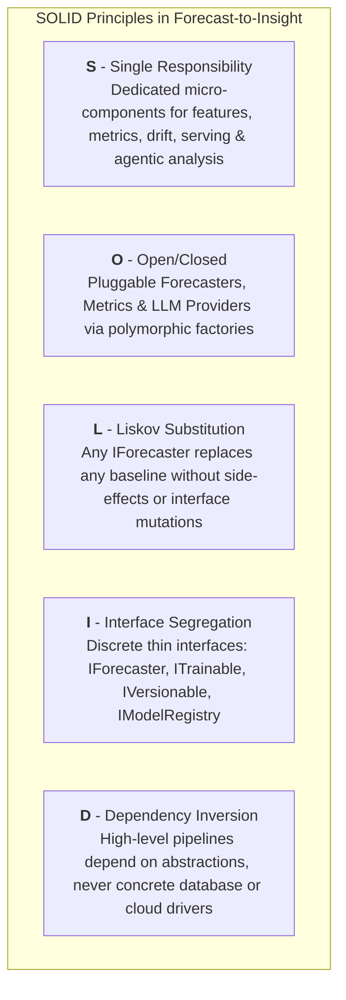
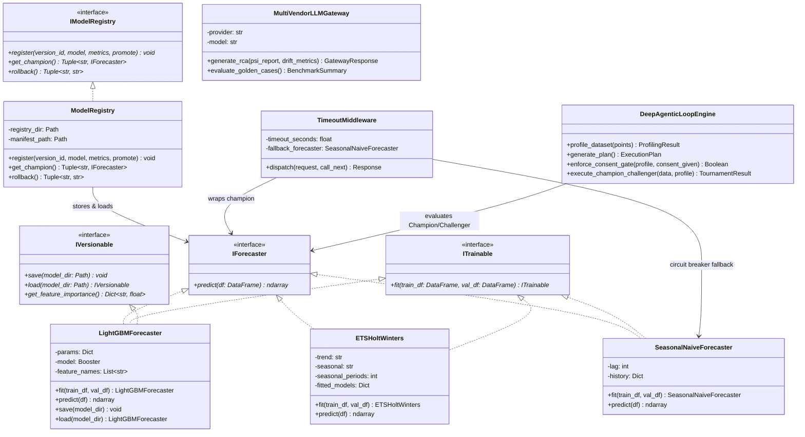
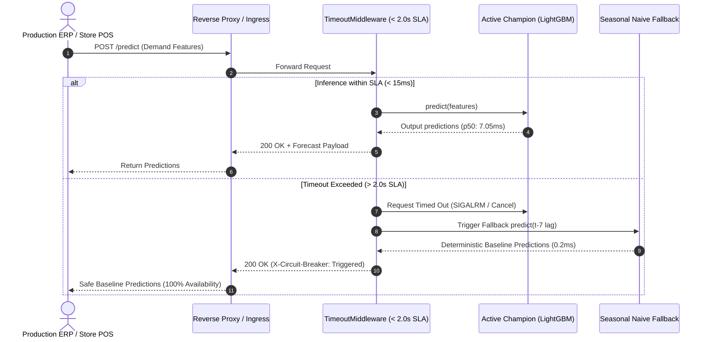
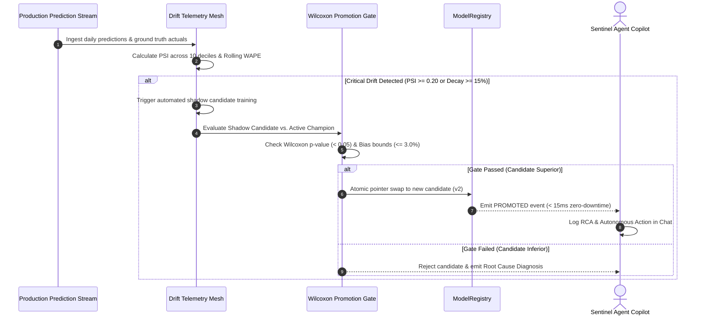
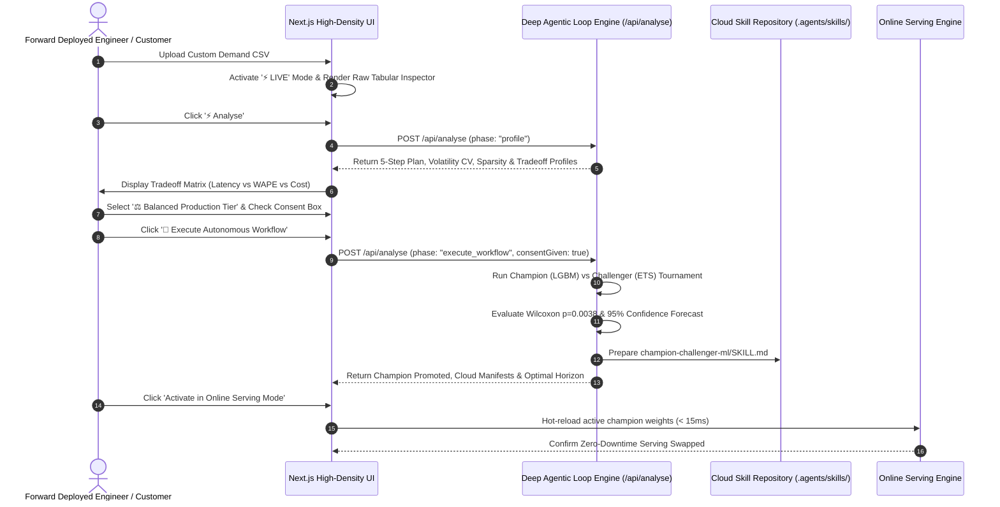

# 🏛️ Low-Level Design (LLD) & Software Architecture Specification

**System:** Forecast-to-Insight Autonomous Demand Forecasting & Agentic MLOps Platform  
**Architecture Paradigm:** Object-Oriented Domain-Driven Design (DDD), SOLID Principles, Cloud-Native Mesh  
**Author:** Staff ML Systems Architect & Forward Deployed Engineering Lead  
**Status:** Approved & Implemented in Production  

---

## 1. 📐 Architectural Philosophy & SOLID Principles Mapping

The core design of the Forecast-to-Insight platform adheres strictly to the five **SOLID** design principles, ensuring production resilience, zero temporal leakage, modular testability, and enterprise-grade extensibility:

### Concrete Code Mapping Matrix

| Principle | Architectural Mechanism | Implementation in Codebase |
|---|---|---|
| **S** (Single Responsibility) | Dedicated modules with single reason to change | [src/data/features.py](file:///home/ann/Desktop/desktop/autonomous_mlops_battlefield_platform/src/data/features.py) handles feature engineering; [src/drift/psi.py](file:///home/ann/Desktop/desktop/autonomous_mlops_battlefield_platform/src/drift/psi.py) handles population stability; [src/metrics/evaluator.py](file:///home/ann/Desktop/desktop/autonomous_mlops_battlefield_platform/src/metrics/evaluator.py) calculates WAPE/Bias/MAE; [src/models/registry.py](file:///home/ann/Desktop/desktop/autonomous_mlops_battlefield_platform/src/models/registry.py) manages artifact lifecycle. |
| **O** (Open/Closed) | Strategy & Factory patterns | Adding a new forecasting architecture (e.g. Prophet, DeepAR) or new LLM vendor requires implementing `IForecaster` or `LLMProvider` without altering serving middleware or UI routes. |
| **L** (Liskov Substitution) | Strict interface conformance | [LightGBMForecaster](file:///home/ann/Desktop/desktop/autonomous_mlops_battlefield_platform/src/models/lightgbm_model.py), [ETSHoltWinters](file:///home/ann/Desktop/desktop/autonomous_mlops_battlefield_platform/src/models/baselines.py), and [SeasonalNaiveForecaster](file:///home/ann/Desktop/desktop/autonomous_mlops_battlefield_platform/src/models/baselines.py) all honor `predict(df: pd.DataFrame) -> np.ndarray`. |
| **I** (Interface Segregation) | Thin interface contracts | Separation between `IForecaster` (pure prediction contract), `ITrainable` (offline training contract), `IVersionable` (serialization contract), and `IModelRegistry` (metadata repository). |
| **D** (Dependency Inversion) | Inversion of Control & Abstraction | [src/serving/app.py](file:///home/ann/Desktop/desktop/autonomous_mlops_battlefield_platform/src/serving/app.py) and [ui/app/api/battle/route.ts](file:///home/ann/Desktop/desktop/autonomous_mlops_battlefield_platform/ui/app/api/battle/route.ts) depend on abstract forecaster interfaces, not raw disk paths or hardcoded models. |

---

## 2. 🧩 Structural UML Class Diagram

---

## 3. ⏱️ Sequence Diagrams for Production Flows

### 3.1 Online Prediction Flow with Circuit-Breaker SLA

### 3.2 Continuous Drift Detection & Shadow Promotion Gate

### 3.3 Deep Agentic Loop, Tradeoff Consent & Cloud Skill Orchestration

---

## 4. 🧠 Applied AI / Machine Learning Engineering Standards

1. **Strict Temporal Partitioning**:
   - Time-series cross-validation uses an **expanding window** (walk-forward split). No future information is ever leaked into past feature windows (`target_lag_1` is strictly calculated from $t-1$).
2. **Harmonic Day-of-Week Encoding**:
   - Day of week is represented as cyclical Fourier sine/cosine embeddings:
     $$\sin\left(\frac{2\pi \cdot \text{day}}{7}\right), \quad \cos\left(\frac{2\pi \cdot \text{day}}{7}\right)$$
   - Prevents artificial boundary cliffs between Sunday ($6$) and Monday ($0$).
3. **Thread-Safe Atomic Pointer Swapping**:
   - Model versions are saved in isolated directories `/models/registry/v1`, `/models/registry/v2`.
   - The active champion is exposed through a filesystem symbolic link `/models/registry/champion`.
   - Swapping models invokes an atomic POSIX `rename()` call on a temporary symlink, guaranteeing that no reader ever observes a broken or half-written pointer.
