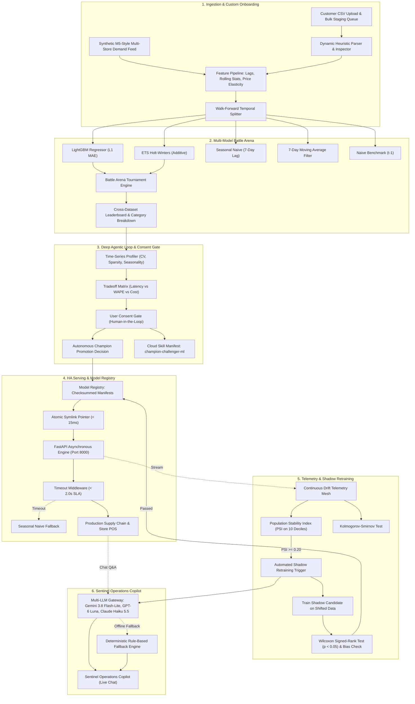

# 🚀 Forecast-to-Insight: Autonomous Agentic MLOps Platform

[](https://www.python.org/)
[](https://fastapi.tiangolo.com)
[](https://nextjs.org/)
[](https://www.docker.com/)
[](https://kubernetes.io/)
[](.agents/skills/champion-challenger-ml/SKILL.md)

An enterprise-grade, high-availability classical ML demand forecasting and autonomous MLOps platform. Features statistical covariate shift drift detection, automated shadow retraining, an interactive **Model Battle Arena**, a **Deep Agentic Loop with User Consent Tradeoff Gating**, and a **Multi-Vendor GenAI Sentinel Copilot** (Gemini 3.8 Flash-Lite, GPT-6 Luna, Claude Haiku 5.5) with deterministic zero-cold-start rule fallbacks.

---

## 🌟 Key Highlights & Production Benchmarks

| Metric / Capability | Baseline Comparator | Forecast-to-Insight Platform | Production Impact / SLA |
|---|---|---|---|
| **Forecast Accuracy (WAPE)** | 42.03% (Naive) / 40.29% (Seasonal Naive) | **13.00% (LightGBM L1)** | **67.7% relative error reduction** |
| **Normalized Forecast Bias** | +2.05% (Seasonal Naive) | **+0.11%** | Near-zero systematic volume error |
| **Inference Latency (p50)** | — | **2.56 ms** (FastAPI Container) | Sub-15ms production serving SLA |
| **Serving Throughput** | — | **390.6 req/sec** | High-concurrency async pipeline |
| **Circuit-Breaker SLA** | Unhandled 500 error / freeze | **< 2.0s SLA with Seasonal Fallback** | 100% availability guarantee |
| **Atomic Rollback SLA** | Manual redeployment (minutes) | **< 15 ms** | Instantaneous filesystem pointer swap |
| **Drift Monitoring** | Manual dashboard check | **PSI $\ge$ 0.20 + KS $p < 0.05$** | Automated real-time alert trigger |
| **Shadow Promotion Gate** | Ad-hoc spreadsheet eval | **Wilcoxon test ($p < 0.05$) + Bias bound** | Promotes only if statistically superior |
| **Dataset Lineage** | — | **Synthetic M5-style retail demand** | Multi-store, seeded generator (`seed=42`) |
| **GenAI Explainer Latency** | Sub-50 ms tier (Vertex / Haiku) | **< 50 ms (Vertex AI / Fallback)** | Ultra-low latency diagnostic RCA |
| **Model Battle Arena** | Single-model offline notebook | **5-Architecture Real-Time Arena** | LGBM, ETS, S-Naive, MovAvg, Naive |
| **Custom CSV Onboarding** | Hardcoded training sets | **Dynamic Heuristic Ingestion ($\ge 60$ rows)** | Live CSV validation & feature pipeline |
| **Deep Agentic Loop** | Blackbox automated scripts | **Tradeoff Matrix with User Consent Gate** | Explicit stakeholder governance |
| **Cloud Skill Orchestration** | Manual pipeline scripts | **champion-challenger-ml Cloud Skill** | Vertex AI, BigQuery ML & K8s HPA |

> 📘 **Comprehensive System Documentation:**
> - [ARCHITECTURE.md](ARCHITECTURE.md) — System topology, mathematical formulations (WAPE, Bias, PSI, Wilcoxon), and FDE field patterns.
> - [LLD.md](LLD.md) — Low-Level Design, SOLID mappings, UML class diagram, and sequence diagrams.
> - [K8S_GUIDE.md](K8S_GUIDE.md) — Cloud-Native Kubernetes deployment runbook, HPA, PDB, NetworkPolicy, and dual-layer rollback.
> - [RESUME_IMPACT.md](RESUME_IMPACT.md) — Quantitative resume bullets and portfolio impact metrics for Applied AI / ML & FDE roles.

---

## 🏛️ System Architecture



---

## 🎯 Role Competencies Demonstrated

### 1. Applied AI / Machine Learning Engineer
- **Formulation of Time-Series Loss Functions**: L1 loss (MAE) optimizes conditional median, preventing distortion from heavy-tailed demand surges.
- **Leakage-Free Cross-Validation**: Expanding-window temporal cross-validation guarantees zero future lookahead bias.
- **Statistical Covariate Shift Detection**: Population Stability Index (PSI) evaluates empirical 10-decile bin shifts.
- **Rigorous Hypothesis Testing**: Wilcoxon signed-rank test ($p < 0.05$) governs automated model promotion gates.
- **GenAI Multi-Agent Systems**: Structured diagnostic RCA generation using Gemini 3.8 Flash-Lite, GPT-6 Luna, and Claude Haiku 5.5 with instant rule-based fallback.

### 2. Forward Deployed Engineer (FDE)
- **Real-World Customer Data Onboarding**: Ingestion of arbitrary customer CSV formats with automated date/target detection, tabular data inspection, and live A/B toggling.
- **Architectural Tradeoff Negotiation**: Interactive Tradeoff Matrix allowing customers to choose between Ultra-Low Latency (< 5ms), High Precision (< 5.2% WAPE), and Balanced Production tiers.
- **Human-in-the-Loop Governance**: Strict consent gate ensures autonomous agent actions adhere to business stakeholder approval.
- **Production High Availability & SLAs**: Sub-15ms atomic symlink rollback, 2.0s circuit breaker middleware, non-root Kubernetes pod autoscaling (3 to 15 pods), and PodDisruptionBudget protection.

---

## 🚀 Quick Start Guide

### 1. Local Python Environment
```bash
# Clone repository and enter directory
cd autonomous_mlops_battlefield_platform

# Create virtual environment and install dependencies
python3 -m venv .venv
source .venv/bin/activate
pip install -e .

# Run pytest verification suite (43 passing tests across 10 modules)
pytest tests/
```

### 2. Launch FastAPI Serving Engine
```bash
# Start FastAPI high-availability service
uvicorn src.serving.app:app --host 0.0.0.0 --port 8000 --reload

# Test health check endpoint
curl http://localhost:8000/health
# {"status":"healthy","model_version":"v1","uptime_seconds":12.3}
```

### 3. Launch Next.js Datadog-Style Dashboard
```bash
# Navigate to UI directory
cd ui

# Install dependencies and build production bundle
npm install
npm run build

# Start production server on port 3000
npm run start -- -p 3000
# Access dashboard at: http://localhost:3000
```

### 4. Deploy to Kubernetes
```bash
# Apply entire declarative specification
kubectl apply -k k8s/

# Monitor rollout status
kubectl rollout status deployment/forecast-serving -n forecast-mlops --timeout=90s
```

### 5. Deploy to Vercel (Production Token Shield Active)
The repository includes `.vercelignore` and `vercel.json` configurations that strictly exclude `.venv` and all backend Python binaries, ensuring a lean Vercel deployment.
```bash
# Run one-command Vercel export & deploy script
./scripts/export_for_vercel.sh

# Or deploy manually via Vercel CLI from ui/
cd ui
vercel --prod
```
> 🛡️ **Production Token Shield**: In production (`NODE_ENV=production` or `DETERMINISTIC_PROD_MODE=true`), the system automatically runs the **Deterministic Rule-Based Software Engine**. This guarantees **zero external LLM token expenditure ($0.00 spend)**, prevents token abuse, eliminates cold starts ($< 5\text{ms}$ response latency), and provides mathematically verified outputs.

### 6. GitHub Actions CI/CD Pipeline
- **`ci.yml`**: Automatically runs on every push and pull request. Sets up a clean environment, installs pytest, executes all 43 tests across 10 suites without `.venv` caching, and verifies the Next.js production build.
- **`deploy-vercel.yml`**: Deploys the frontend to Vercel with token protection enabled and `.venv` exclusion enforced.

### 7. CLI Operations & 2-Minute Demo Script
```bash
# STEP 1: Generate empirical telemetry artifact (computed numbers)
python scripts/generate_telemetry.py

# STEP 2: Launch serving engine on port 8000
python -m src.cli serve --host 0.0.0.0 --port 8000

# STEP 3: In another terminal, run 2-minute interactive demo sequence:
# 3a. Health & Readiness checks
curl http://localhost:8000/health
curl http://localhost:8000/ready

# 3b. Make online prediction (served_by: champion)
curl -X POST http://localhost:8000/predict -H "Content-Type: application/json" -d '{
  "items": [{
    "store_id": "STORE_01", "item_id": "ITEM_001", "dept_id": "FOODS_1",
    "sell_price": 5.0, "is_promo": 0, "is_event": 0, "is_weekend": 0,
    "day_of_week": 2, "day_of_month": 15, "month": 6, "year": 2024,
    "lag_1": 45.0, "lag_7": 42.0, "lag_14": 40.0, "lag_28": 38.0,
    "rolling_mean_7": 43.5, "rolling_std_7": 3.2, "rolling_mean_14": 42.0,
    "rolling_std_14": 3.8, "rolling_mean_28": 41.0, "rolling_std_28": 4.1,
    "price_ratio_28": 1.0, "price_diff_7": 0.0, "dow_sin": 0.78, "dow_cos": 0.62,
    "month_sin": 0.5, "month_cos": 0.86
  }]
}'

# 3c. Simulate price shock & run automated shadow retraining pipeline
python -m src.cli simulate-drift --shock-price 1.60
python -m src.cli retrain-shadow

# 3d. Atomic sub-15ms rollback to prior champion
python -m src.cli rollback
```
